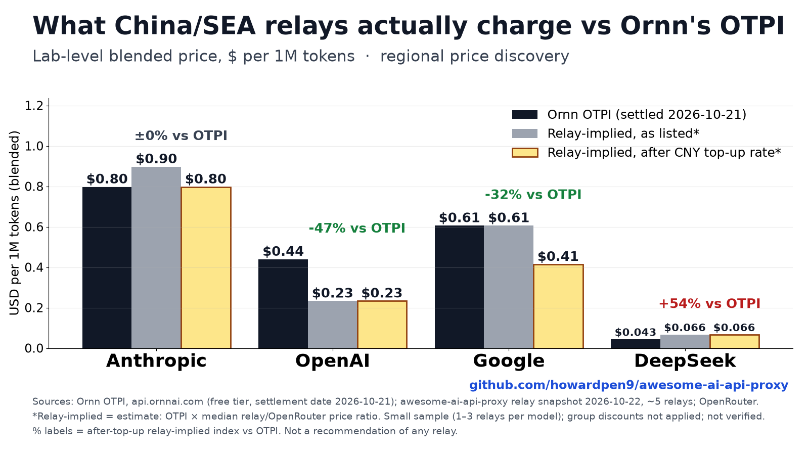

# China/SEA relay prices vs Ornn OTPI (regional price discovery)

A one-off snapshot comparing posted per-token prices from China/SEA API relays (中轉站) in this repo against
[Ornn's Token Price Index (OTPI)](https://api.ornnai.com) and OpenRouter's posted prices.
It is **regional price discovery**: it describes public prices and is **not** a resale offer or a recommendation of any relay.



## Snapshot

| Input | Value |
|---|---|
| Ornn OTPI | `GET https://api.ornnai.com/api/otpi` (free tier), settlement date **2026-10-21**, fetched 2026-10-23T10:27Z |
| Relay + OpenRouter prices | `data/prices.latest.json` @ `50bfda9`, snapshot **2026-10-22** |
| Top-up rates | each relay's public new-api `/api/status`, fetched 2026-10-23 ~10:28Z |
| FX | USD/CNY 6.6882, open.er-api.com, 2026-10-23 |

## Caveats (please read before citing)

- **The lab-level "relay-implied index" is an estimate, not an observed price**: OTPI × median(relay ÷ OpenRouter) across the lab's matched models. OTPI's free tier has no per-model or input/output split.
- **Small sample**: 5 relays (uiuiapi, relaydance, teamorouter, wappkit, unorouter), only **1–3 relays per model**. Three of them are operator-submitted/unverified.
- **Group discounts are not applied**: prices use the default/listed new-api group ratio, so some relay prices are likely overstated.
- **Top-up FX adjustment covers only the Alipay/WeChat path** (`/api/status.price`, CNY per 1 USD of quota). Card/Stripe rates and bonus tiers are ignored.
- **No canary verification**: no model was test-called, so we cannot confirm that a relay serves the model it names.
- bltcy (柏拉图) is excluded because it announced a shutdown (API service ended 2026-05-01).

Full methodology: [METHODOLOGY.md](METHODOLOGY.md).

## Files

- `otpi_vs_relays.csv` / `.json`: per-model rows (the JSON also has per-relay detail, flags and exclusions)
- `otpi_lab_level.csv`: lab-level OTPI vs relay-implied index (listed and top-up adjusted)
- `chart.png` / `chart.svg`: full chart; `x-preview.png`: 1600×900 lab-level summary
- `raw/`: raw OTPI API responses (including the 401s for keyed labs), relay `/api/status` + `/api/pricing` responses, FX
- `build.py`, `chart.py`, `x_preview.py`: scripts to reproduce

## Reproduce

```bash
pip install matplotlib numpy
# Exact reproduction needs the relay snapshot this was built on:
git worktree add /tmp/aap-50bfda9 50bfda9
AAP_ROOT=/tmp/aap-50bfda9 python research/ornn-otpi/build.py
python research/ornn-otpi/chart.py
python research/ornn-otpi/x_preview.py
```

If `AAP_ROOT` is not set, `build.py` reads `data/prices.latest.json` from the current checkout. The OTPI and relay inputs come from the frozen files in `raw/`; nothing is fetched live.
